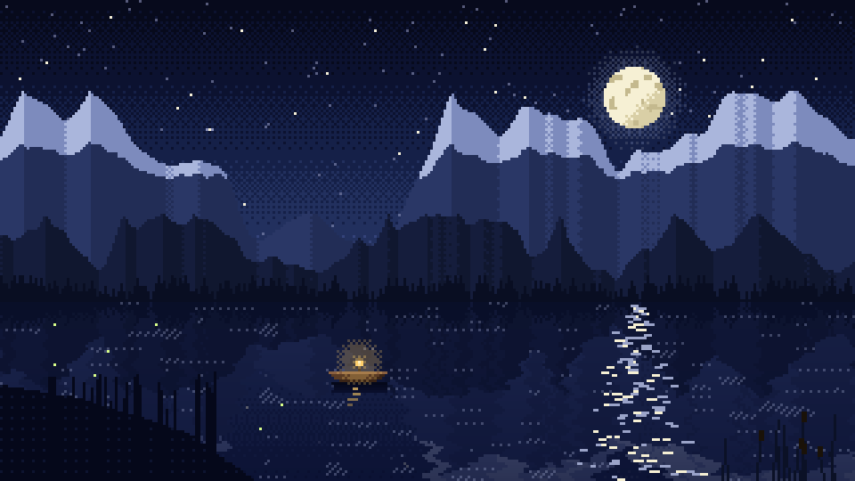

# Pixel Scenery Studio

> **Art style: pixel art.** One of a family of scenery studios. Each one makes live wallpapers in one
> art style, with the same layout and workflow. To start a studio for another style, see
> [docs/new-art-style.md](docs/new-art-style.md).

Make animated **pixel-art live wallpapers** with Claude. You describe a scene and drop in some
reference pictures. Claude asks a few questions, draws the scene in code, shows you previews, and
renders a seamless looping 1080p video that plays on your Omarchy desktop through
[omarchy-live-wallpaper](https://github.com/VienJunaid/omarchy-live-wallpaper).



## Making a new scene

1. *(Optional)* Put reference images in `inbox/`: a photo of the place, a painting whose colours
   you like, a photo of the people who should be in it.
2. Open Claude Code in this folder and run:

   ```
   /new-scene
   ```

   or just say *"make a new scene"*, or give a head start: `/new-scene a harbour at night with fishing boats`.
3. Claude interviews you, a few questions at a time:
   - **the place:** what it is and what the focus is
   - **your images:** what to take from each (layout, colours, a building, an outfit)
   - **time and mood:** time of day, weather, season
   - **characters:** who, what they wear, what they're doing (or none)
   - **motion:** what should move (water, clouds, lanterns, birds, people walking)
   - **the name** shown in the wallpaper picker
4. Claude sums up, then draws it and shows you preview images. Tell it what to change; repeat
   until you like it.
5. Claude renders the video and installs it into the picker. Pick it with
   **SUPER+SPACE → Style → Live wallpaper**, or run `live-wallpaper set pixel-scenery/<scene>`.

## Doing it by hand

Needs **Node 20+** and **ffmpeg**. Nothing to install.

```bash
npm run new -- harbour-at-night --label "Harbour at Night" --from inbox/
# edit scenes/harbour-at-night/scene.mjs
npm run preview -- harbour-at-night   # out/harbour-at-night/preview.png + sheet.png
npm run render  -- harbour-at-night   # out/harbour-at-night/harbour-at-night.mp4
npm run export  -- harbour-at-night   # into ~/.config/omarchy-live-wallpaper/packs/pixel-scenery/
```

| Command | |
|---|---|
| `npm run new -- <id>` | new scene folder (`--label`, `--subtitle`, `--from <image or folder>`) |
| `npm run preview -- <id>` | still images of the scene, and a check that the loop is seamless |
| `npm run render -- <id> --at 0.5` | one still from halfway through the loop |
| `npm run check -- <id>` | only the loop check |
| `npm run render -- <id>` | the full video (a 60 s loop renders in seconds) |
| `npm run export -- <id>` | add it to the wallpaper picker (`--all` for every rendered scene, `--pack <id>` for another pack) |

## What's in a scene

```
scenes/harbour-at-night/
├── brief.md        what the scene should be: your answers to the interview, plus every change you asked for
├── scene.json      the picker name and subtitle, bar colours, and any overrides (loop length, fps)
├── scene.mjs       the drawing code: a static background built once, plus what moves each frame
└── reference/      your images for this scene
```

`scenes/lantern-lake/` is a complete example.

## How it works

- Scenes are drawn at **320×180** pixels with a small toolkit (`engine/pixels.mjs`: shapes,
  dithered gradients, stepped glows, sprites, noise) and scaled ×6 to 1920×1080 with hard edges, so
  every pixel stays crisp.
- Everything that moves is tied to how far through the loop the frame is, repeating a whole number
  of times, so **the last frame flows exactly into the first**. Every render checks this.
- Frames are piped straight from Node into ffmpeg. There's no browser and no screen recording, so
  the same scene always renders the same video.
- `npm run export` copies the video into an omarchy-live-wallpaper pack and writes its name and bar
  colours into the pack's `pack.json`, so the bar matches the scene.

| File | |
|---|---|
| [CLAUDE.md](CLAUDE.md) | the workflow Claude follows, and the owner's standing rules |
| [STYLE.md](STYLE.md) | the pixel-art rules every scene follows |
| [docs/scene-api.md](docs/scene-api.md) | the drawing API for `scene.mjs` |
| [docs/new-art-style.md](docs/new-art-style.md) | turning this into a studio for another art style |
| `studio.json` | the art style, resolution, frame rate, loop length and pack name |

## Origins

The first scenes (Al-Aqsa, the Kaaba, Madinah, Hagia Sophia, the Al-Farooq night market, the
Kazakh meadow) were made inside [rpi-dashboard](https://github.com/VienJunaid/rpi-dashboard), a
Raspberry Pi home screen, and recorded from it as video. This studio takes the same pixel-art
approach and makes it a standalone tool for wallpapers.

## License

MIT. See [LICENSE](LICENSE). This covers the code and the example scene. Reference images you add
for your own scenes stay yours and are never committed (`inbox/` is gitignored; keep personal photos
out of scenes you share).
